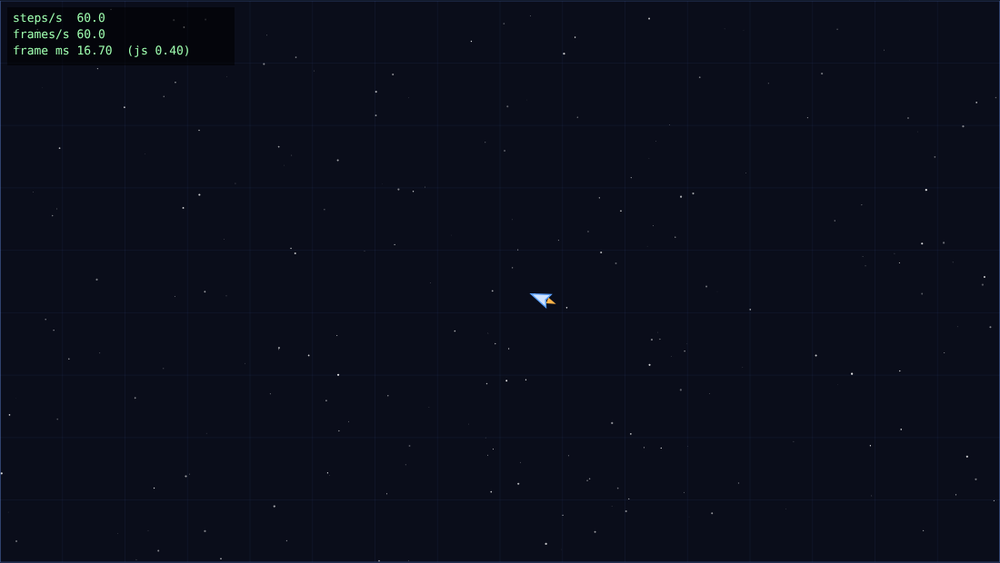
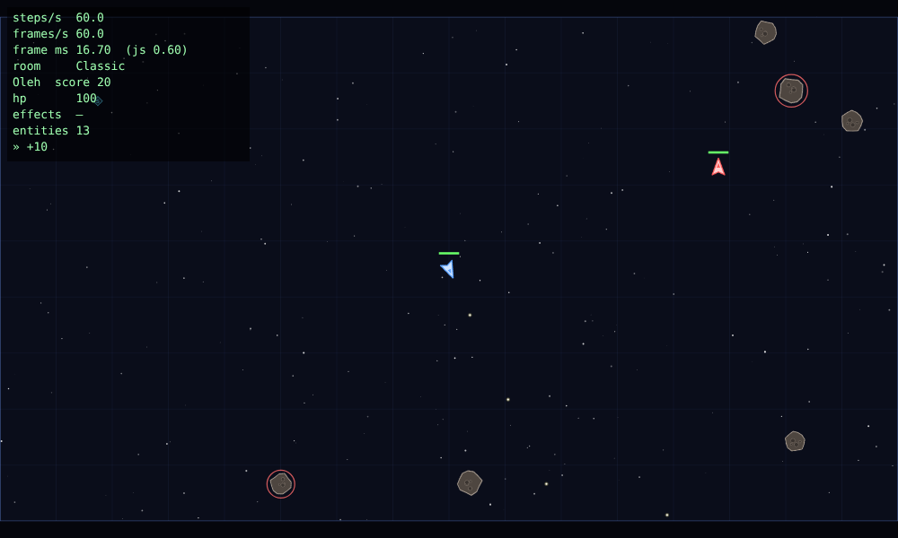

# Spacefight

Мультиплеєрна браузерна гра з космічними кораблями. Проєкт курсу «JavaScript: мультиплеєрна гра», який будується протягом 8 лабораторних (кожна лаба позначена тегом `lab-0N`).



## Запуск

```bash
nvm use            # Node 22 (.nvmrc)
npm install
npm run dev        # http://localhost:5173
```

`npm run build` збирає production-версію, `npm run lint` запускає перевірку Biome (лінтер + форматер), `npm run format` автоматично виправляє знайдене.

**Керування:** `W`/`↑` для газу, `A D`/`← →` для повороту, `Space` для стрільби (затиснути).



Запуск: завантаження ассетів → лобі (ім’я + кімната) → гра.

---

## Lab 01 — Event loop і ігровий цикл

> Нижче описано стан на тезі `lab-01`. З Lab 2 функція `integrate(ship, command, dt)` розділилася на `Ship.control(command, dt)` (поворот, газ, тертя, обмеження швидкості) і `Entity.update(dt)` (рух). Фізика від цього не змінилась: експеримент `?exp=fixed&auto=1` дає ту саму позицію `964.7644576798393, 472.5317580176354`.

### Що зроблено

| Вимога                                                                                                | Де в коді                                                         |
| ----------------------------------------------------------------------------------------------------- | ----------------------------------------------------------------- |
| Ігровий цикл на `requestAnimationFrame` + акумулятор із clamp 0.25 с, `alpha` для рендеру             | `src/loop.js` → `createLoop({ step, simulate, render })`          |
| Лічильники steps/s, frames/s, frame ms у HUD                                                          | `createStats()` у `src/loop.js`, `drawHud` у `src/render/draw.js` |
| Клавіатура як замикання з `isDown` і `justPressed` (+`consume`, ігнор `e.repeat`, скидання на `blur`) | `src/input.js` → `createInput()`                                  |
| Чиста фізика `integrate(ship, command, dt)` без DOM                                                   | `src/sim/ship.js`                                                 |
| Арена з «загортанням» країв; lerp, який не тягне корабель через усю арену                             | `src/sim/arena.js`                                                |
| Інтерполяція `previous → current` і `lerpAngle` (коротким шляхом по колу)                             | `src/render/draw.js`                                              |
| Canvas з урахуванням `devicePixelRatio`, ресайз                                                       | `src/render/canvas.js`                                            |
| Сітка й зоряне поле, щоб було видно рух                                                               | `src/render/draw.js`                                              |
| Експерименти M4 (вмикаються параметром URL, основний код лишається чистим)                            | `src/dev/experiments.js`                                          |

### Рішення, закладені під наступні лаби

- **`src/sim/` не має жодних залежностей від браузера**: немає DOM, `Date.now()` чи `Math.random()`. У Lab 5 ця папка без змін переїде в `shared/` і запускатиметься на сервері.
- **Симуляція отримує команду `{ thrust, turn, fire }`, а не клавіатуру.** Перетворення клавіш на команду робить `readControls()` у `input.js`. Саме цю команду в Lab 5 клієнт надсилатиме на сервер.
- **Арена має фіксований розмір у світових координатах (1600×900)** і вписується у вікно під час рендеру. Тому в мультиплеєрі гравці з різними моніторами житимуть в одному світі.
- **`integrate` змінює об’єкт на місці**, а всі поля корабля створюються одразу й в одному порядку. Так не створюється сміття для GC і зберігається одна «форма» об’єкта (Lab 7).
- `createStats()` зберігає останні 600 інтервалів кадрів у `Float64Array`. Звідти в Lab 7 рахуватимуться p50/p95/p99.

### Чому фізика має саме такі параметри (M2)

`turnRate 3.6 рад/с` дає повний оберт приблизно за 1.7 с: корабель достатньо швидко розвертається, щоб ухилятися, але ним ще можна прицілитись. `thrust 320 px/с²` разом із `maxSpeed 420 px/с` означає, що арену шириною 1600 корабель перетинає приблизно за 4 с. `drag 0.55/с` потрібен, щоб без газу корабель плавно зупинявся і не дрейфував вічно. Інакше в маленькій арені з «загортанням» ним важко керувати. Обмеження швидкості потрібне, щоб корабель не розганявся нескінченно (для колізій у Lab 2).

---

### M4 — три навмисні поломки

Усі поломки вмикаються параметром URL, наприклад `http://localhost:5173/?exp=block`. Звичайна гра модуль експериментів не завантажує. Через 10 с у консоль виводиться статистика інтервалів кадрів (mean/std/min/p50/p95/max).

| Параметр               | Що ламає                                                          |
| ---------------------- | ----------------------------------------------------------------- |
| `?exp=block`           | busy-wait 100 мс у `render` кожен 60-й кадр                       |
| `?exp=interval`        | `setInterval(frame, 16)` замість rAF                              |
| `?exp=variable&auto=1` | змінний крок: один `simulate(dt)` на кадр + автопілот             |
| `?exp=fixed&auto=1`    | нормальний фіксований крок + той самий автопілот (для порівняння) |

**Середовище замірів:** Chromium (Playwright), Linux, віртуальний дисплей 60 Гц, вікно 1280×720. Числа нижче зняті саме там. Дефенд варто повторити на своєму моніторі: якщо він 120/144 Гц, frames/s буде відповідно 120/144, а steps/s однаково 60.

#### Еталон: нормальний цикл (rAF + фіксований крок)

| steps/s | frames/s | інтервал кадру mean ± std | p95     | max                                    |
| ------- | -------- | ------------------------- | ------- | -------------------------------------- |
| 60.0    | 60.0     | 16.69 ± 0.68 мс           | 16.8 мс | 33.3 мс (один пропущений кадр за 10 с) |

#### Експеримент 1 — блокуючий цикл у кадрі (`?exp=block`)

```js
if (frame % 60 === 0) {
  const t = performance.now()
  while (performance.now() < t + 100) {}
}
```

|             | steps/s  | frames/s | інтервал mean ± std  | max          |
| ----------- | -------- | -------- | -------------------- | ------------ |
| Норма       | 60.0     | 60.0     | 16.69 ± 0.68 мс      | 33.3 мс      |
| Блок 100 мс | **60.0** | **55.1** | 18.05 ± **10.55** мс | **100.1 мс** |

**Що бачить гравець:** раз на секунду гра «замерзає» приблизно на 0.1 с, а потім корабель стрибком опиняється далі. HUD показує, що frames/s падає до ~55 (за секунду втрачається близько 6 кадрів, бо 100 мс ≈ 6 × 16.7), а frame ms у цей момент сягає 100. **steps/s при цьому лишається рівно 60:** після блоку акумулятор отримує 0.1 с і в наступному кадрі виконує ~6 кроків симуляції поспіль. Час гри не відстає, проте картинка смикається.

**Чому це неможливо обійти з JavaScript у тому самому потоці.** JS у вкладці має один потік і один стек викликів. Event loop бере наступну задачу, виконує rAF і малює кадр лише тоді, коли стек порожній. Поки `while` крутиться, стек зайнятий, і нічого іншого не відбувається: ні paint, ні обробник клавіш, ні таймер, ні мікрозадачі. Функцію, що вже виконується, ніщо не перериває (run-to-completion). `await`, `setTimeout` чи проміс усередині тут не допоможуть, бо вони лише кладуть роботу в чергу, а черги обробляються після того, як звільниться стек. Позбутися блокування можна тільки двома способами: не робити такої роботи в головному потоці (поділити її на шматки між кадрами) або винести її в окремий потік, тобто Worker (Lab 7).

#### Експеримент 2 — `setInterval(frame, 16)` замість rAF (`?exp=interval`)

|                   | frames/s | інтервал mean ± std | min … max          | p95     |
| ----------------- | -------- | ------------------- | ------------------ | ------- |
| rAF               | 60.0     | 16.69 ± 0.68 мс     | 16.5 … 33.3 мс     | 16.8 мс |
| `setInterval(16)` | **62.5** | 16.00 ± 0.48 мс     | **13.2 … 18.4 мс** | 16.7 мс |

**Фонова вкладка на 5 с** (вимірювання за 5.5 с: 5 с у фоні + 0.5 с після повернення):

|                   | кроків симуляції за 5.5 с (норма ≈ 330)                                    | найдовший інтервал кадру |
| ----------------- | -------------------------------------------------------------------------- | ------------------------ |
| rAF               | **130**: rAF майже зупинився (~1 кадр/с), clamp 0.25 с не дав надолужувати | **1016.7 мс**            |
| `setInterval(16)` | **339**: таймер працював далі, як ні в чому не бувало                      | 46.4 мс                  |

**Висновки:**
1. **Частота не збігається з дисплеєм.** 16 мс ≠ 16.67 мс, тому таймер спрацьовує 62.5 раза на секунду, а екран оновлюється 60. Приблизно 2–3 рази на секунду два «кадри» потрапляють між двома paint: один рендер виконується даремно, а рух стає нерівним (judder). Інтервали «пливуть» від 13 до 18 мс, бо таймер є звичайною задачею в черзі і чекає, доки звільниться стек, і нічого не знає про vsync. rAF натомість викликається браузером як крок рендерингу безпосередньо перед paint.
2. **Фон.** rAF у фоновій вкладці браузер призупиняє (тут ~1 Гц, у звичайному desktop Chrome на прихованій вкладці він зупиняється повністю). Гра «стає на паузу» і не витрачає CPU. `setInterval` продовжує працювати й ганяти симуляцію та рендер, хоча кадрів ніхто не бачить. Chrome урізає таймери прихованих вкладок до ≥1 с лише з часом, тобто поведінка непередбачувана.
3. Кроків симуляції в обох варіантах ~60/с, бо акумулятор однаково рахує реальний час. Цикл з фіксованим кроком захищає фізику навіть від поганого джерела кадрів, але не робить картинку плавною.

_Примітка щодо середовища:_ у цьому браузері Playwright не генерував `visibilitychange` під час перемикання вкладок, проте rAF однаково був пригальмований до ~1 кадру/с. У звичайному Chrome варто повторити: перемкнутися на іншу вкладку на 5 с і повернутися, після чого в консолі видно звіт.

#### Експеримент 3 — змінний крок замість фіксованого (`?exp=variable&auto=1`)

Автопілот затискає **газ + поворот праворуч** на 5 с часу симуляції, після чого виводить позицію корабля. Старт у точці (800, 450), кут −90°. Throttling CPU 6× вмикався через DevTools Protocol (`Emulation.setCPUThrottlingRate`), так само як у DevTools → Performance → CPU 6× slowdown.

| Цикл                | Запуск                   | час симуляції | x                     | y                     |
| ------------------- | ------------------------ | ------------- | --------------------- | --------------------- |
| **Фіксований** 1/60 | без throttling           | 5.000000      | **964.7644576798393** | **472.5317580176354** |
| **Фіксований** 1/60 | CPU 6×                   | 5.000000      | **964.7644576798393** | **472.5317580176354** |
| Змінний             | без throttling, запуск 1 | 5.016467      | 961.7787              | 478.5036              |
| Змінний             | без throttling, запуск 2 | 5.016567      | 964.1418              | 473.3698              |
| Змінний             | CPU 6×                   | 5.016467      | 968.4876              | 476.9332              |

**Висновок:** з фіксованим кроком позиція збігається **до останнього біта** (ті самі 300 кроків по 1/60 с), хоча під throttling окремі кадри тривали до 66.7 мс. Зі змінним кроком розбіжність становить до **~7 px** між запусками, причому навіть два запуски без throttling на одній машині дають різний результат. Причина в тому, що інтегрування Ейлера з поворотом і тертям залежить від розміру кроку: ті самі 5 с, поділені на інші шматки, дають іншу траєкторію. Розмір шматків визначається тим, коли event loop дійшов до rAF, тобто навантаженням машини. Крім того, «рівно 5 с» досягти неможливо, бо останній кадр завжди проскакує межу.

**Чому це важливо:** у Lab 5 клієнт і сервер повинні отримувати однаковий результат з однакових команд (client-side prediction). Зі змінним кроком вони роз’їдуться вже за кілька секунд. Тому симуляція завжди крокує по 1/60 с, а плавність забезпечує інтерполяція в рендері.

Після експериментів код гри лишається незмінним: усі поломки ізольовані в `src/dev/experiments.js` і за замовчуванням вимкнені.

---

### Чекліст Lab 01

- [x] Vite, `"type": "module"`, Biome, `.nvmrc`
- [x] `createLoop`: rAF + clamped accumulator; steps/s, frames/s, frame time у HUD
- [x] `createInput`: замикання з `isDown` і `justPressed`
- [x] Чиста `integrate(ship, input, dt)`; wrap-around; `sim/` без DOM
- [x] Інтерполяція з правильним `lerpAngle`; DPR-aware canvas з ресайзом
- [x] Експерименти 1–3 з числами та поясненням через event loop
- [x] Тег `lab-01`

---

## Lab 02 — Об’єкти, `class`, `this`: модель сутностей

### Що зроблено

| Вимога                                                                                                                                         | Де в коді                                                   |
| ---------------------------------------------------------------------------------------------------------------------------------------------- | ----------------------------------------------------------- |
| `Vector2`: чисті методи `add/sub/scale/length/normalize/rotate/dot/fromAngle` + `*InPlace` для гарячого шляху                                  | `src/sim/vector.js`                                         |
| `Entity` (`id`, `pos`, `vel`, `angle`, `radius`, `kind`, `alive`, `update`), приватний лічильник `static #nextId` / `#id`                      | `src/sim/entity.js`                                         |
| `Ship extends Entity` (один рівень), `#hp` + `get hp()`, `fire()` з носа з успадкованою швидкістю                                              | `src/sim/ship.js`                                           |
| `Bullet` (TTL 1.1 с), `Asteroid` (дрейф і обертання), `Explosion` (18 частинок, 0.8 с)                                                         | `src/sim/entity.js`                                         |
| `World` над `Map<id, Entity>`: `spawn`, `despawn` (позначка) + `#sweep` наприкінці кроку, `[Symbol.iterator]`, `*ofKind`, `step(dt, commands)` | `src/sim/world.js`                                          |
| Коло-коло колізії окремою системою: генератор пар `findCollisions` + правила `resolveCollisions`                                               | `src/sim/collision.js`                                      |
| Шкода, вибух, респаун через 2 с у безпечній точці, рахунок (астероїд +10, корабель +100) у HUD                                                 | `collision.js`, `world.js`, `main.js`                       |
| Homing і pickup через композицію                                                                                                               | `src/sim/components.js`                                     |
| Демонстрація бага з `this`                                                                                                                     | `src/dev/experiments.js` (`?exp=this-bug`, `?exp=this-fix`) |

**Що в грі:** ваш корабель (синій), корабель-мішень без пілота (червоний; на ньому видно шкоду, вибух і респаун), 6 астероїдів (кожен 4-й є «мисливцем» з homing і має червоний обрис), pickup раз на ~6 с: `S` щит 5 с, `R` швидка стрільба 6 с, `H` самонавідні кулі 8 с.

**Порядок одного кроку `World.step`:** зберегти попередній стан (для інтерполяції) → команди кораблям і постріли → система homing → `update` усіх сутностей + загортання → колізії → респаун і підтримка кількості астероїдів/pickup → `#sweep` мертвих → додати сутності, заспавнені під час кроку (щоб не змінювати `Map` посеред обходу).

**Під наступні лаби:** `sim/` і далі не залежить від DOM. Перевірено в Node: 3600 кроків зі стрільбою, колізіями й респауном дають однаковий результат при двох запусках з одним seed. Випадковість іде тільки через seeded `mulberry32` (`sim/random.js`). Команди надходять у `World.step` як `Map<shipId, command>`, саме так їх передаватиме сервер у Lab 5.

### Баг із `this` (`?exp=this-bug`)

`Ship.fire()` читає `this.solid`, `this.cooldown`, `this.pos`. Наївне підключення до клавіатури:

```js
window.addEventListener('keydown', ship.fire) // передали ФУНКЦІЮ, а не виклик ship.fire()
```

`this` визначається **в момент виклику**, а не тим, «чий це метод». Слухач викликає браузер, і він підставляє `this = window` (елемент, на якому висить слухач). Вивід у консолі (`?exp=this-bug`):

```
[this-bug] голий виклик: TypeError Cannot read properties of undefined (reading 'solid')
[this-bug] this у setTimeout === window: true
[this-bug] this у слухачі === window: true
```

- **Слухач / `setTimeout(ship.fire)`:** `this === window`, `window.solid` дорівнює `undefined`, тому `!this.solid` дає `true` і `fire` **мовчки повертає `null`**. Помилки немає, але й пострілу теж. Це найпідступніший варіант бага. (Цікава деталь: у браузері таймер теж кличе колбек з `this = window`, а не `undefined`.)
- **Голий виклик `const f = ship.fire; f()`:** правило default binding, код класу завжди strict, тому `this === undefined` і виникає `TypeError`.

**Фікс і альтернативи** (`?exp=this-fix`, клавіша `F` → `[this-fix] fire() → куля #9`):

| Спосіб                      | Як                                               | Мінус                                                                                                   |
| --------------------------- | ------------------------------------------------ | ------------------------------------------------------------------------------------------------------- |
| Стрілка-обгортка            | `addEventListener('keydown', () => ship.fire())` | нова функція при кожній реєстрації; щоб зняти слухач, її треба десь зберегти                            |
| `bind` (використано в демо) | `const fire = ship.fire.bind(ship)`              | так само окрема функція; `bind` не можна «перебити» пізніше через `call`/`bind`                         |
| Поле-стрілка в класі        | `fire = () => { … }`                             | своя копія функції в **кожному** екземплярі, а не одна на прототипі: для 1000 сутностей це 1000 функцій |

**Що вибрано в грі.** Клавіатура взагалі не викликає `fire`. `readControls()` перетворює клавіші на дані `{ thrust, turn, fire }`, а `World.step` сам викликає `ship.fire()` через крапку (implicit binding, `this = ship`). Причин дві: постріл має відбуватися всередині фіксованого кроку симуляції, а не в момент події клавіатури (Lab 1), і в Lab 5 ця сама команда прийде з мережі, де ніякого слухача немає.

### Чому композиція, а не дерево класів

**Як виглядала б ієрархія.** Спочатку все просто: `Entity → MovingEntity → Ship / Bullet / Asteroid`. Потім треба додати:

- **homing** для кулі _і_ для астероїда. Доведеться робити `HomingBullet extends Bullet` і `HomingAsteroid extends Asteroid` з однаковим скопійованим кодом наведення або вставляти `HomingEntity` у середину дерева (`MovingEntity → HomingEntity → Bullet`). Тоді «наводитися» вмітимуть _усі_ кулі, і доведеться ще й вимикати це прапорцем.
- **pickup**, який стоїть на місці, бере участь у колізіях, але не є кораблем. Він не `MovingEntity`, тож з’являється друга гілка `Entity → StaticEntity → Pickup`, а колізії (спільні для обох гілок) знову доводиться піднімати в корінь.
- **Ефекти pickup змінюються під час гри:** куля стає самонавідною, коли гравець підібрав `H`. Клас об’єкта після `new` не змінити, тому довелося б створювати _іншу_ кулю іншого класу.

Кожна нова фіча вимагає перебудовувати дерево. Якщо поведінки комбінуються (homing × bullet/asteroid, щит × швидка стрільба), кількість класів росте як добуток.

**Що зроблено.** Наслідування лише одного рівня (`Ship/Bullet/Asteroid/Explosion extends Entity`) для того, що в сутності є завжди (позиція, рух, TTL). Усе додаткове реалізовано **компонентами-полями** з даними, які обробляє окрема **система**:

```js
bullet.homing = homing({ targets: ['asteroid', 'ship'], turnRate: 4, range: 380 }) // куля з H
asteroid.homing = homing({ targets: ['ship'], turnRate: 0.7, range: 450 }) // «мисливець»
const p = createPickup({ x, y, effect: 'shield' }) // звичайний Entity + p.pickup = { effect }
// система: for (const e of world) if (e.homing) … — їй байдуже, куля це чи астероїд
```

**Чому саме так (поля-компоненти, а не міксини чи повний ECS):**

1. **Поведінку можна додати або зняти під час гри:** `bullet.homing = …` або `= null`, без нового класу.
2. **Будь-яка комбінація без нових класів:** homing на кулі, на астероїді, а за потреби й на кораблі.
3. **Компоненти є звичайними даними** (`{ targets, turnRate, range }`, `{ effect }`), тому їх легко серіалізувати для мережевих знімків у Lab 5. Функції в стані довелося б відновлювати.
4. **Одна «форма» об’єктів:** `homing` і `pickup` оголошені в конструкторі `Entity` як `null`, тож усі сутності мають однаковий набір полів у тому самому порядку (це знадобиться в Lab 7, hidden classes). Міксини через `Object.assign` додавали б поля після створення об’єкта й плодили б різні форми.
5. Повний ECS (масиви компонентів, сутність як індекс) для шести видів сутностей є надлишковим. Це Stretch і Lab 7.

**Ціна:** системи перевіряють `if (e.homing)` на кожній сутності, а правила колізій зібрані в одному `switch` за парою `kind`. Для нашої кількості сутностей це дешево й легко читається.

### Досліди в консолі (notes §1–3)

- `Object.create(a)`: `b.hello` дає `1`, `b.hasOwnProperty('hello')` дає `false`, після `a.hello = 2` маємо `b.hello === 2`. Метод не копіюється, а знаходиться пошуком по прототипу. Тому тисяча куль ділить один `Bullet.prototype.update`.
- `const m = a.m; m()` дає `undefined`, а `m.call(a)` дає `a` (див. баг вище).
- `{1:'x'}` перетворює ключ на рядок `'1'`, а в `Map` ключі `1` і `'1'` різні. Тому id сутностей зберігаються в `Map`.

### Чекліст Lab 02

- [x] `Vector2` з чистими методами; `Entity` з приватним статичним лічильником id; `Ship extends Entity` (один рівень)
- [x] `World` над `Map`, ітерабельний через `[Symbol.iterator]`, `*ofKind`, відкладене видалення через sweep
- [x] `Bullet` (TTL), `Asteroid`, `Explosion` (частинки), pickup; `Ship.fire()`
- [x] Баг із `this` задокументовано з обраним фіксом і альтернативами
- [x] Коло-коло колізії окремою системою; шкода через `#hp`; респаун; рахунок у HUD
- [x] Homing і pickup через композицію; дизайн-запис
- [x] Тег `lab-02`

---

## Lab 03 — Асинхронний JavaScript: ассети, звук, лобі

### Що зроблено

| Вимога                                                                                                                                                           | Де в коді                                                        |
| ---------------------------------------------------------------------------------------------------------------------------------------------------------------- | ---------------------------------------------------------------- |
| `fetchJson` перевіряє `ok`, кидає `HttpError`; `loadImage` / `loadAudio` / `loadJson` приймають `AbortSignal`                                                    | `src/assets/loader.js`                                           |
| `withRetry`: exponential backoff + jitter, свій таймаут на кожну спробу, **без ретраю на 4xx**, `AbortError` і `SyntaxError`                                     | `src/assets/loader.js`                                           |
| `loadAll`: спрайти через `Promise.all` (критичні), звуки через `Promise.allSettled` (необов’язкові), прогрес по кожному файлу                                    | `src/assets/loader.js`                                           |
| Прогрес-бар на canvas, кнопки «Скасувати» / «Retry»; гра стартує лише після `await loadAll`                                                                      | `src/render/loading.js`, `src/main.js`                           |
| Маніфест і спрайтшит з атласом; кораблі, кулі, астероїди, pickup малюються через `drawImage` із source rect                                                      | `public/assets/`, `drawSprite` у `src/render/draw.js`            |
| Web Audio: `AudioContext` + `decodeAudioData` під час завантаження, `resume()` після жесту (клік Join / клавіша)                                                 | `src/audio.js`                                                   |
| Шина подій: `world.events` (`EventTarget`) + `CustomEvent` `fired` / `hit` / `exploded` (+ `scored`, `picked`); звук і HUD підписуються ззовні                   | `src/sim/world.js`, `collision.js`, `src/audio.js`, `src/hud.js` |
| `class Lobby extends EventTarget`: `enter` / `refresh` / `join` / `leave`, оновлення кожні 5 с, `AbortSignal.timeout(3000)` на кожен запит, `abort()` при виході | `src/lobby/lobby.js`                                             |
| DOM лобі окремо, лише слухає події; подія `join` перетворена на проміс                                                                                           | `src/lobby/lobby-view.js`                                        |
| `GET /api/rooms` — поки статичний `public/api/rooms.json`; «Join» стартує гру з конфігом арени кімнати (розмір, seed, кількість астероїдів)                      | `public/api/rooms.json`, `createGame` у `src/main.js`            |

**Сим не імпортує ні звук, ні HUD.** Усі імпорти `src/sim/`: `entity`, `vector`, `components`, `collision`, `random`, `arena`. Шина є звичайним `EventTarget`, тож у Node вона теж працює: 3600 кроків дали `fired: 225, exploded: 40, scored: 39, picked: 1, hit: 1`. Це знадобиться серверу в Lab 5.

**Чому спрайти через `fetch` → `blob` → `Image`, а не голий `img.src`:** так видно HTTP-статус. 404 не ретраїться, 503 ретраїться. Колбек-API `Image` загорнутий у `new Promise`, тож порядок однаковий і з кешу, і з мережі.

### Sequential `await` vs `Promise.all`

`?exp=loadtime&slow=1`: 6 файлів (атлас, спрайтшит, 4 звуки), кожен із затримкою сервера 150 / 400 / 200 / 250 / 300 / 350 мс (сума 1650 мс, максимум 400 мс). 5 прогонів, кеш обходиться параметром `run=N`. Chromium, localhost.

| Спосіб                                                        | Прогони, мс                  | Медіана     |
| ------------------------------------------------------------- | ---------------------------- | ----------- |
| `for (…) await job()`: наступний стартує після попереднього   | 1694, 1687, 1692, 1691, 1692 | **1692 мс** |
| `await Promise.all(jobs.map(j => j()))`: усі стартують одразу | 411, 409, 411, 412, 410      | **411 мс**  |

**Висновок: різниця в ~4.1 раза.** Послідовний варіант займає приблизно суму затримок (1650 мс + декодування), паралельний — приблизно найдовший файл (400 мс). Справа не в слові `await`, а в тому, **коли стартує** робота: `const a = await loadA(); const b = await loadB()` запускає B тільки після A.

### П’ять головоломок порядку

Кожну перевірено в Chromium тричі, вивід стабільний.

**1. `await` на вже виконаній async-функції**

```js
async function f() {
  log('A')
  await g()
  log('B')
}
async function g() {
  log('C')
}
f()
Promise.resolve().then(() => log('D'))
log('E')
```

Вивід: `A, C, E, B, D`. `g()` виконується синхронно (C) і повертає готовий проміс. Продовження після `await` стає в мікрочергу **раніше**, ніж `.then(D)`, бо `f()` дійшов до `await` до того, як зареєстрували D.

**2. `setTimeout` всередині `.then`**

```js
setTimeout(() => log(1))
Promise.resolve()
  .then(() => {
    log(2)
    setTimeout(() => log(3))
  })
  .then(() => log(4))
log(5)
```

Вивід: `5, 2, 4, 1, 3`. Спершу виконуються вся мікрочерга (2, потім 4 з ланцюжка), потім задачі в порядку постановки: таймер 1 поставили раніше за таймер 3, який з’явився лише всередині `.then`.

**3. `requestAnimationFrame`**

```js
requestAnimationFrame(() => {
  log('raf1')
  setTimeout(() => log('timeout from raf'))
  Promise.resolve().then(() => log('micro from raf'))
  requestAnimationFrame(() => log('raf2'))
})
log('sync')
```

Вивід: `sync, raf1, micro from raf, timeout from raf, raf2`. rAF є кроком рендерингу перед paint. Після кожного rAF-колбека мікрочерга спорожнюється. Таймер — звичайна задача, яка встигає раніше за наступний кадр (~16 мс), а `raf2` виконується вже в наступному кадрі.

**4. Порядок результатів `Promise.all`**

```js
const p = (n, ms) =>
  new Promise((r) =>
    setTimeout(() => {
      log('done ' + n)
      r(n)
    }, ms),
  )
;(async () => {
  const res = await Promise.all([p(1, 30), p(2, 10)])
  log(JSON.stringify(res))
})()
log('started')
```

Вивід: `started, done 2, done 1, [1,2]`. Обидві роботи стартують одразу й завершуються за своїми таймерами (2 швидший). Масив результатів зберігає порядок **входу**, а не завершення.

**5. Помилка в async, `catch`, `finally`**

```js
async function boom() {
  throw new Error('x')
}
boom()
  .catch((e) => log('caught ' + e.message))
  .finally(() => log('finally'))
Promise.reject(new Error('y')).then(
  () => log('never'),
  (e) => log('handled ' + e.message),
)
log('sync')
```

Вивід: `sync, caught x, handled y, finally`. `throw` в async-функції означає відхилений проміс. Реакції стають у чергу в порядку реєстрації (caught, потім handled). `finally` прив’язаний до проміса, який повертає `.catch`, тому стає в чергу лише після виконання `catch`, тобто вже після `handled`.

### Галерея збоїв

Збої вмикаються параметром URL (`npm run dev`, далі `http://localhost:5173/?fault=…`). Затримки, битий JSON і 503 робить middleware у `vite.config.js`, який працює тільки в dev/preview. `appType: 'mpa'` вимикає SPA-fallback, тому неіснуючий файл повертає справжній 404, а не `index.html`.

| Збій                           | URL                                     | Що відбувається                                                                                                                                                                                                           | Чим закінчується                                                                                                     |
| ------------------------------ | --------------------------------------- | ------------------------------------------------------------------------------------------------------------------------------------------------------------------------------------------------------------------------- | -------------------------------------------------------------------------------------------------------------------- |
| **404 спрайта**                | `?fault=404`                            | `HttpError 404` → **без ретраю** (4xx не виправиться повтором) → `Promise.all` відхиляється одразу. Звуки ще вантажаться (`all` нікого не скасовує), тож `controller.abort()` зупиняє їх: у мережі 4 запити `ERR_ABORTED` | «Сервер відповів 404» + **Retry** ([скрин](docs/gallery/404.png))                                                    |
| **Таймаут мережі**             | `?fault=timeout`                        | звук `explode` відповідає 10 с, а таймаут спроби 3 с → `TimeoutError` → retry через 230 і 501 мс (jitter) → 3 спроби вичерпано. Звуки йдуть через `allSettled`, тому критичні ассети не страждають                        | **гра стартує** без цього звуку, у лобі видно «⚠ звук "explode" не завантажився» ([скрин](docs/gallery/timeout.png)) |
| **Abort посеред завантаження** | `?fault=abort` (або кнопка «Скасувати») | повільне завантаження, `abort()` через 200 мс → `AbortError` у всіх. 5 запитів, що ще висіли, скасовано (`ERR_ABORTED`), backoff-паузи теж перериваються                                                                  | «Завантаження скасовано» + **Retry** → друга спроба вантажиться, з’являється лобі ([скрин](docs/gallery/abort.png))  |
| **Битий JSON**                 | `?fault=badjson`                        | атлас обрізаний → `res.json()` кидає `SyntaxError` (заголовки прийшли, `ok === true`, зламаний другий крок — тіло). Без ретраю                                                                                            | «Битий JSON: Unterminated string…» + **Retry** ([скрин](docs/gallery/badjson.png))                                   |
| _503, бонус_                   | `?fault=flaky`                          | спрайтшит двічі відповідає 503 → `[retry] HttpError → спроба 2 через 340 мс` → `спроба 3 через 261 мс` → успіх                                                                                                            | гра стартує ([скрин](docs/gallery/flaky.png))                                                                        |
| _Таймаут лобі, бонус_          | `?fault=lobby-timeout`                  | `/api/rooms` відповідає 5 с, а `AbortSignal.timeout(3000)` спрацьовує раніше                                                                                                                                              | у лобі «Не вдалося оновити список (TimeoutError)», автоповтор за 5 с ([скрин](docs/gallery/lobby-timeout.png))       |

**Скасування лобі (перевірено в браузері).** Поки лобі видиме, за 5.5 с пройшло 2 запити `/api/rooms`, а за 6 с після Join — **0**. Інтервал знято, `AbortController` скасував запит, що ще висів. Якщо відповідь усе ж прийде «з того світу», `refresh` перевіряє `controller.signal.aborted` і нічого не малює.

**Що є promise, а що подія.** Ассет, список кімнат і «гравець натиснув Join» трапляються **один раз**, тому це проміси (`await loadAll`, `once(lobby, 'join')`). Постріл, влучання й вибух трапляються **багато разів**, тому це події `CustomEvent` на шині, яку слухають `audio.js` і `hud.js`.

### Чекліст Lab 03

- [x] `loadImage` / `loadAudio` / `loadJson` з `AbortSignal`; `fetchJson` перевіряє `ok`; `withRetry` з backoff + jitter, без ретраю на 4xx
- [x] `loadAll` через `Promise.all` з прогресом по кожному файлу; прогрес-бар на canvas; sequential vs concurrent у README
- [x] Спрайти з атласу; Web Audio, розблокований жестом; декодування під час завантаження
- [x] Шина `EventTarget` / `CustomEvent`; сим не імпортує audio/HUD
- [x] Лобі (`extends EventTarget`) з періодичним оновленням, `AbortSignal.timeout`, abort при виході; рендер в окремому модулі
- [x] П’ять власних головоломок порядку з поясненнями; галерея збоїв (404, таймаут, abort, битий JSON)
- [x] Тег `lab-03`
